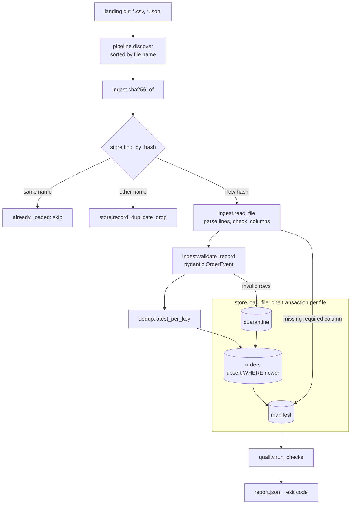

# datapulse

A command-line batch pipeline that loads CSV and JSONL drops from a landing directory into DuckDB
and can be killed at any point and rerun without double counting. Each file is hashed, validated
row by row, deduplicated by natural key and upserted in a single transaction together with its
manifest entry. Data-quality checks run after the load and fail the run with a non-zero exit code.

## Problem

File-based feeds go wrong in the same few ways: a producer re-sends yesterday's file, a few rows
are corrupt, events arrive late or out of order, a partner renames a column, and the loader
crashes halfway through. A naive loader then double counts the re-sent file, fails the whole
batch over one bad row, lets an old event overwrite newer state, or leaves half a file in the
warehouse after a crash, so that the rerun loads that half again.

## Why it matters

Reruns are the normal way to recover a batch pipeline. If the rerun after a crash does not give
the same result as a run that never crashed, nobody can trust the numbers downstream, and
someone has to repair rows by hand. A row that is rejected without its file, line, field and
reason cannot be fixed at the source.

## What it does

- **Ingest** `*.csv` and `*.jsonl` files sitting directly in the landing directory, in file name
  order. Other files (for example `*.part` uploads in progress) are ignored.
- **Content-hash manifest**: every file's SHA-256 is recorded. A file whose hash is already in
  the manifest is skipped: `already_loaded` under the same name, `duplicate_drop` (recorded in
  its own table) under a different name. A changed file with the same name is a new drop.
- **Validation** with a pydantic model (`src/datapulse/schema.py`): patterns, ranges, enums,
  required fields, timezone-aware timestamps normalised to UTC, exact decimals (JSON numbers
  are parsed as `Decimal`, never as binary floats).
- **Quarantine**: invalid rows are stored with file, line, field, reason and the raw line. Valid
  rows in the same file still load. Unreadable lines (bad UTF-8, broken JSON, wrong number of
  CSV fields) are quarantined with field `_row`.
- **Schema drift**: a file missing a required column is rejected as a whole and recorded in the
  manifest with the reason. Unknown extra columns are allowed, ignored and recorded.
- **Deduplication** by `order_id` with a deterministic "latest wins" rule: greatest event time,
  then later file, then later line. The same rule is applied inside a file (in Python) and
  against stored state (in the upsert's `WHERE`), so late events never overwrite newer state.
- **Restart safety**: quarantine rows, warehouse upsert and manifest entry for one file are
  written in one DuckDB transaction. A crash anywhere before `COMMIT` leaves no trace of that
  file, and the rerun loads it again.
- **Data-quality checks** with thresholds from TOML: row count, quarantine rate, rejected files,
  null rates, amount range, freshness against `--as-of`, duplicate keys. The result is written
  as a JSON report; any failing check makes `run` and `check` exit with code 1.
- **Seeded generator** for test data that contains each of the problems above.

## Architecture



Inside `store.load_file` the order is quarantine insert, staging insert and upsert, manifest
insert, `COMMIT`. The manifest row is what marks a file as done. Crash points
(`after_quarantine`, `after_upsert`, `before_commit`, `after_commit`) sit between these steps.

| Module | Responsibility |
| --- | --- |
| `schema.py` | `OrderEvent` contract, `ValidRow` with lineage and `precedence` |
| `ingest.py` | hashing, line-oriented CSV/JSONL parsing, column checks, row validation |
| `dedup.py` | `latest_per_key` |
| `store.py` | DuckDB DDL, `load_file` transaction, upsert SQL, manifest |
| `pipeline.py` | discovery and per-file decisions |
| `quality.py` | checks and the JSON report |
| `export.py` | deterministic CSV export of every table |
| `crash.py` | `DATAPULSE_CRASH_AT` crash injection |
| `generator.py` | seeded synthetic landing data and ground truth |
| `cli.py`, `demo.py` | command line and the demo |

## Technology choices

- **DuckDB** (embedded): real transactions and `INSERT ... ON CONFLICT DO UPDATE ... WHERE`
  without a database server, which keeps the demo and CI to `uv sync`. Its file lock also
  stops a second process from writing at the same time.
- **pydantic v2** for row validation: field-level error locations give the quarantine its
  `field` and `reason` columns.
- **Standard library** for the rest: `csv`, `json`, `hashlib`, `tomllib`, `argparse`.
- **uv** with a committed `uv.lock`; **ruff** (including the bandit `S` rules), **mypy --strict**
  and **pytest**. The reasons and alternatives are in
  [docs/ENGINEERING_DECISIONS.md](docs/ENGINEERING_DECISIONS.md).

## Installation

Requires [uv](https://docs.astral.sh/uv/). uv installs Python 3.12 if needed.

```sh
git clone <this repository> datapulse
cd datapulse
uv sync --locked
```

## Quick start

```sh
uv run datapulse demo
```

The demo writes only to `./.datapulse-demo/` (or `--workdir DIR`), which it deletes and
recreates on each run. It refuses to touch a non-empty directory it did not create. It:

1. generates seeded landing data (seed 42);
2. loads it into `clean.duckdb`;
3. runs the same load in a child process with
   `DATAPULSE_CRASH_AT=before_commit:orders_2026-01-05.csv`, which exits with code 86 mid-file;
4. reruns that command without the crash;
5. exports every table plus the report for both databases and compares SHA-256 digests;
6. runs the clean pipeline again to show every file is skipped and nothing changes;

and then prints the data-quality report, plus the result of the same state under a stricter
threshold. It exits 0 only if the outputs match and the checks pass.

## Examples

Excerpt of `uv run datapulse demo` output (complete and deterministic for seed 42):

```text
[2/6] Reference run with no crash -> clean.duckdb
  loaded          orders_2026-01-01.csv  (96 valid, 2 quarantined, 0 stale)
  loaded          orders_2026-01-02.jsonl  (150 valid, 3 quarantined, 1 stale)
  loaded          orders_2026-01-03.csv  (148 valid, 3 quarantined, 7 stale)
  duplicate_drop  orders_2026-01-03_resend.csv  (same content as orders_2026-01-03.csv)
  loaded          orders_2026-01-04.jsonl  (180 valid, 4 quarantined, 1 stale)
  loaded          orders_2026-01-05.csv  (203 valid, 4 quarantined, 6 stale)
  rejected        orders_2026-01-05_partner.csv  (schema drift: missing required columns amount; unexpected columns channel, total_amount)
  loaded          orders_2026-01-06.jsonl  (195 valid, 4 quarantined, 4 stale, extra columns: channel)
  loaded          orders_2026-01-07.csv  (241 valid, 5 quarantined, 7 stale)
  loaded          orders_2026-01-08.jsonl  (246 valid, 5 quarantined, 4 stale)

[3/6] Same run in a child process with DATAPULSE_CRASH_AT=before_commit:orders_2026-01-05.csv -> crashed.duckdb
  datapulse: injected crash at before_commit while loading orders_2026-01-05.csv
  child exit code: 86 (injected crash exits 86)
  manifest after crash: 4 files committed; orders_2026-01-05.csv is not among them

[5/6] Compare outputs: clean run vs crash + rerun (table exports and DQ report)
  manifest.csv         c70f498debb7d427  identical
  duplicate_drops.csv  42b0916cadfdb44b  identical
  quarantine.csv       f790f7d265037261  identical
  orders.csv           f3cc63725b654d49  identical
  report.json          a8e4adadfca06073  identical
```

"stale" counts valid rows that lost to newer state already in the warehouse (late data).

Using the commands directly:

```sh
uv run datapulse generate --out landing --seed 42
uv run datapulse run --landing landing --db warehouse.duckdb --config datapulse.toml \
    --as-of 2026-01-09T00:00:00Z --report report.json
echo $?      # 0: all checks passed
uv run datapulse check --db warehouse.duckdb --as-of 2026-01-09T00:00:00Z
echo $?      # 1: built-in defaults allow 0 rejected files; the partner file was rejected
uv run datapulse export --db warehouse.duckdb --out out
```

A quarantine row as exported in `out/quarantine.csv`:

```text
file_seq,file_name,line,field,reason,raw
1,orders_2026-01-01.csv,39,amount,Input should be a valid decimal,"ORD-100028,CUS-55508,placed,1,""12,50"",THB,2026-01-01T18:49:00Z,"
```

Exit codes: `0` success, `1` a data-quality check failed, `2` bad arguments, `3` runtime error
(missing landing directory, invalid config, database locked by another process), `86` injected
crash.

Configuration (`datapulse.toml`, every key optional, unknown keys rejected):

```toml
[checks]
min_orders = 100
max_quarantine_rate = 0.05
max_rejected_files = 1
max_freshness_lag_hours = 24
amount_min = 0
amount_max = 100000

[checks.max_null_rate]
discount_code = 0.9
```

## Testing

```sh
uv run ruff format --check .
uv run ruff check .
uv run mypy src tests
uv run pytest -q
```

73 tests. What they cover:

- `tests/test_validation.py`, `tests/test_ingest.py`, `tests/test_dedup.py`: field rules and
  quarantine reasons, line numbers, CRLF and BOM input, bad UTF-8, broken JSON, schema drift
  rejection versus extra-column acceptance, the "latest wins" rule including tie-breaks and
  independence from input order.
- `tests/test_pipeline.py`: a full run over generated data equals the generator's independently
  computed ground truth (`Generation.expected_orders`); second run is a no-op; a re-dropped file
  under a new name is skipped; late events and restatements; an ordinary exception mid-file
  rolls the file back.
- `tests/test_restart_safety.py`: for each of the 4 crash points on 2 files, a child process is
  killed with `os._exit`, the run is repeated, and every export and the report must be
  byte-identical to a clean run. Also three successive crashes on different files.
- `tests/test_quality.py`: each threshold can fail on its own, freshness follows `--as-of`,
  config validation, CLI exit codes 1/2/3, a second writer refused while the database is open.
- `tests/test_generator_and_demo.py`: same seed gives the same bytes, a pinned digest for seed
  42 (run on Windows locally and Linux in CI), and the demo end to end.

CI (`.github/workflows/ci.yml`) runs the same commands, the demo, and `pip-audit` on the
dependencies exported from `uv.lock`.

## Limitations

- **One writer at a time.** DuckDB locks the database file; a concurrent run exits with code 3
  rather than waiting.
- **Files are read whole into memory** and staging rows are inserted with `executemany`. This is
  fine for the generated data; no throughput has been measured, and large files would need a
  bulk path (Arrow or DuckDB's own CSV reader).
- **CSV fields with embedded newlines are not supported**, because parsing is per physical line
  to report exact line numbers. Such a row is quarantined as malformed.
- **The byte-identical guarantee covers the exports and the report**, not the `.duckdb` file,
  whose internal layout depends on write history.
- **Tie-break order is load order.** `file_seq` is assigned when a file is loaded. Files in one
  run load in name order, so producers should name files so that name order matches delivery
  order; a file delivered in a later run always counts as later.
- **Rejected and quarantined data is not replayed.** Fixing a rejected file means dropping a
  corrected file (new hash). There is no command to re-validate quarantined rows.
- **Latest wins replaces the whole row.** There is no field-level merge and no delete events.
- **One fixed entity** (orders). The schema lives in code; there is no schema registry.
- **Checks run on the cumulative state**, not per run, and freshness uses the wall clock unless
  `--as-of` is given.

## Future work

- Bulk loading through Arrow or `read_csv` for large files, with a measured benchmark script.
- A `replay` command that re-validates quarantined rows after a schema change.
- Per-run history (run id, timings, per-run counts) kept separately from the deterministic report.
- Versioned schemas with explicit, tested migrations of the warehouse tables.

## Licence

MIT, see [LICENSE](LICENSE). All data is synthetic and generated by this repository; no external
dataset is used.
